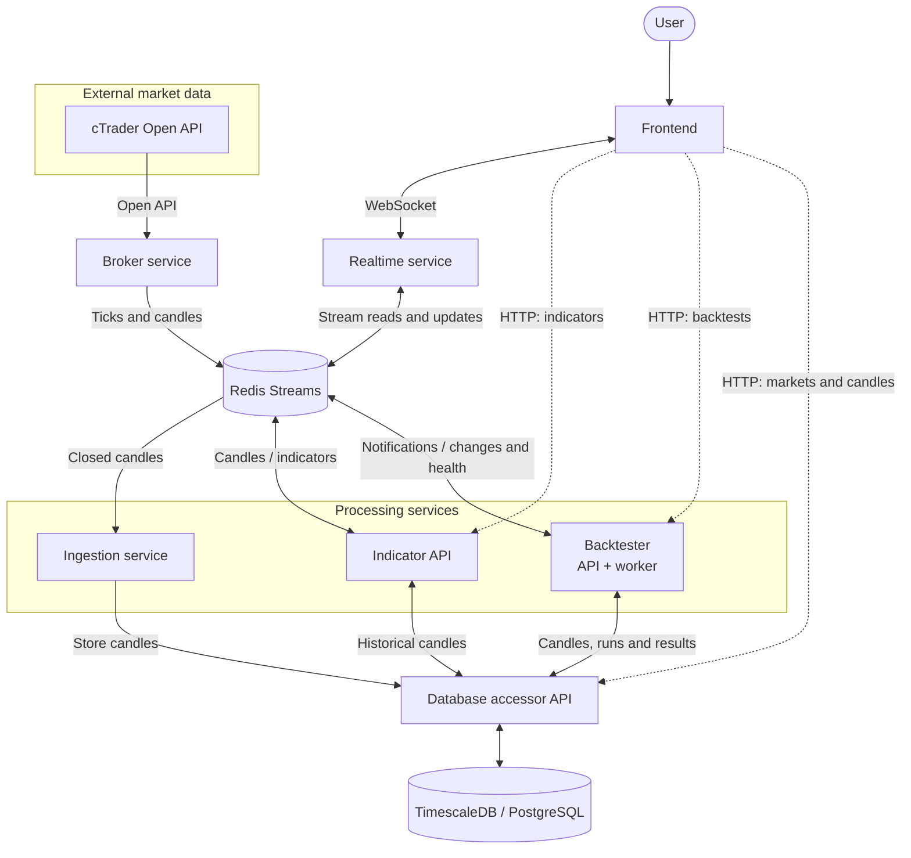

# AlgoTrader

AlgoTrader is an experimental trading project for collecting market data,
visualizing live and historical charts with
[Lightweight Charts](https://tradingview.github.io/lightweight-charts/), and running
historical backtests with fixed or varying parameters.

## Install a versioned release

Download **`algotrader-VERSION.zip`** from
[GitHub Releases](https://github.com/s-stolz/algotrader/releases/latest).
The same installer is used on macOS, Linux, and Windows. GitHub’s **Source code**
archives are for development, not installation.

Follow the short [installation guide](release/README.md) to prepare Docker,
register your cTrader application, and run the setup wizard. Windows support is
experimental until validated with Docker Desktop.

For an existing installation, see [commands and upgrades](release/docs/operations.md).
To change the application’s source, use the development workflow below.

## Architecture



## Development Disclaimer

This project is in active development and may undergo significant changes. **Backward compatibility is not guaranteed**—things might break! Please use this repository **for reference only** and not as a stable library.

## Trading Risk Disclaimer

Trading in derivative instruments—including futures, options, CFDs, Forex, and
certificates—carries significant risk and may not be appropriate for all
investors. There is a possibility of losing the entire initial investment or even more. **Use this project at your own risk.**

## Support the Project

If AlgoTrader has helped you with your algorithmic trading journey, you can support its continued development by using my [IC Trading affiliate link](https://www.ictrading.com?camp=86158) when opening a trading account. IC Trading offers competitive spreads and reliable execution for algorithmic traders.

*Using this link costs you nothing extra but helps fund the development of new features and improvements.*

## Development prerequisites

- [Docker](https://docs.docker.com/get-started/get-docker/) with the Compose v2 plugin (`docker compose`).
- GNU Make (`make`).
- Node 26 active LTS for frontend development (`nvm use` reads `.nvmrc`).
- Python 3.12–3.15 (`python3.15` recommended) with venv support, and PyYAML for host-side config generation.

## Set up a development checkout

1. Clone the repository:
   ```sh
   git clone https://github.com/s-stolz/algotrader.git
   cd algotrader
   ```
2. Create local secrets from the example:
   ```sh
   cp config/.env.secrets.example config/.env.secrets.local
   ```
3. Edit `config/topology.yaml` for shared non-secret settings (ports, hosts, tuning), and edit `config/.env.secrets.local` for credentials/secrets.
   For machine-specific non-secret values, copy `config/topology.local.example.yaml`
   to `config/topology.local.yaml` and edit only the overrides you need. This file is
   ignored by Git. Request historical market data through the application after
   adding a broker market; the legacy ingestion lookback settings do not schedule
   downloads.
4. Generate runtime env files from shared topology + local overrides + local secrets:
   ```sh
   make config
   ```
5. Run the project and explore.

## Running with Docker Compose

Default workflow (auto-regenerates config env files before Compose):
   ```sh
   make up
   ```

Direct Docker Compose usage:
   ```sh
   python3 scripts/generate_env.py --force
   docker compose --env-file config/.env.shared up --build
   ```
This will build and start all necessary services as defined in the `docker-compose.yml` file.

### Asynchronous backtests

Compose starts two processes from the same backtester image:

- `backtester-api` exposes the public API on `http://localhost:18002` by default
  and provides `GET /health`.
- `backtester-worker` is a singleton worker that claims and executes one durable
  run at a time.

Run the backtest smoke checks:

```sh
make smoke-backtester
```

[Worker recovery guide](docs/operations/backtest-worker-recovery.md)

## Central Configuration Model

- Tracked shared topology: `config/topology.yaml`
- Gitignored secrets: `config/.env.secrets.local`
- Generated runtime env files: `config/.env.shared`, `config/.env.secrets.db`, `config/.env.secrets.runtime`, `config/.env.secrets.broker`
- Generator script: `scripts/generate_env.py`

See [the topology schema](config/topology.schema.md) for settings and defaults.

### Validation and overwrite

```sh
python3 scripts/generate_env.py --validate
python3 scripts/generate_env.py --force
```

### Make targets

```sh
make config
make validate-config
make smoke-backtester
make up
make build
make down
make restart
make logs
make ps
```

### Docker resource budgets

Edit `cpus` and `memory_reservation_mb` in each container's `resources` mapping
in `config/topology.yaml`. For example, the worker budget lives at
`services.backtester.worker.resources`, and Redis's budget at
`infrastructure.redis.resources`.
`make config` generates the variables consumed
by `docker-compose.yml`; do not edit generated env files. CPU quotas throttle
execution. Memory reservations are soft and allow containers to exceed the
configured amount; they do not allocate RAM in advance. Hard memory caps are
intentionally omitted because exceeding one can trigger an out-of-memory kill.
Exhausting the Docker VM's memory can still kill processes.

For a 16 GB Mac with 10 logical CPUs, start with **4 CPUs, 6 GB RAM, and 1 GB
swap** in **Docker Desktop → Settings → Resources → Advanced**. This separate
machine setting governs the whole Docker VM, including other projects and builds;
the per-container quotas share that budget. Applying Desktop settings restarts
Docker. Tune these starting values against `docker stats` during representative
backtests and chart use, alongside macOS Activity Monitor's memory pressure.

Apply container configuration between backtests because recreation interrupts
active work:

```sh
make config
docker compose --env-file config/.env.shared config --quiet
make up-detached
```

## Local Python Environments

Use a root virtual environment for shared library/test tooling and per-service virtual environments for service runtime dependencies.

### Shared constraints and service packages

- Shared versions live in `constraints-shared.txt`.
- Each service's `pyproject.toml` owns its direct dependencies and package metadata.
- Services install into separate environments from this checkout; shared libraries
  are resolved from `libs/`, not a public package index.
- If a service must diverge, add `<service>/constraints.override.txt` with a
  rationale comment followed by an exact `package==version` replacement for a
  shared pin. Overrides must satisfy the service's declared dependency ranges.
- `scripts/python_environment.py` merges pins before a single pip resolution.
  Host setup and Docker builds use the same policy. Bare `pip install` does not
  apply repository constraints; use the setup command below.
- Docker first caches third-party dependencies from all library manifests, the
  service manifest, and shared/service constraints. It then copies all library
  and service source and performs the full package installation and validation.
  Source edits still rebuild the image; dependency edits invalidate the earlier
  layer. Pip downloads use a persistent BuildKit cache outside the image.
  Builds require BuildKit with Dockerfile syntax 1.20 support.
- Python services and local tooling support Python 3.12–3.15; containers use Python 3.15.2. Set `PYTHON` to a specific
  supported executable if `python3.15` is not on PATH. Use `--recreate` when replacing
  an environment created with another Python version.

### Bootstrap all service venvs

```sh
make venvs
```

Equivalent direct command:

```sh
./scripts/setup_venvs.sh all
```

This now creates:
- root environment: `.venv` using `requirements.root.txt`
- service environments: `<service>/.venv` using each service package and the effective shared constraints

### Bootstrap only root venv

```sh
make venv-root
```

### Setup one service

```sh
make venv SERVICE=broker-service
```

### Recreate all service venvs

```sh
make venvs-recreate
```

### Validate existing environments

Checks verify Python 3.12–3.15, installed service packages, effective shared pins, and
`pip check`. Only packages actually installed in that environment are compared
with the shared pins.

```sh
make venvs-check
```

## VS Code Multi-Venv Workflow

1. Open `algotrader.code-workspace` in VS Code (not only the repo root folder).
2. The workspace uses `python.defaultInterpreterPath = ${workspaceFolder}/.venv/bin/python`, so each service folder resolves to its own `.venv`.
3. If a service interpreter is not picked up immediately, run `Python: Select Interpreter` once while a file from that service is active.

## License

This project is licensed under the MIT License - see the [LICENSE](LICENSE) file for details.

This project makes use of third-party software so please check the [ATTRIBUTIONS.md](ATTRIBUTIONS.md) file for more information.

## Market data recovery operations

For controlled outage/restart acceptance, migration order, retained Redis data,
and safe restart/rollback, follow the [recovery deployment guide](docs/operations/market-data-recovery.md).
