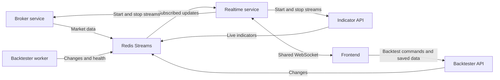

# Realtime Service

The shared WebSocket service delivers live chart updates, backtest change
notifications, and worker health to frontend clients.

## Overview

The service reads Redis Streams and distributes updates to subscribed browsers.
It also starts and stops broker and indicator streams as chart subscriptions
change. Backtest commands and saved-data queries use the backtester HTTP API;
this service delivers the notifications that tell the browser when to refresh.

## Architecture



## Features

- **Shared connection** — Chart and backtest subscriptions use the same socket.
- **Stream management** — Broker and indicator streams start with the first
  subscriber and stop when the last subscriber leaves.
- **Backtest updates** — Change notifications refresh saved workspace data;
  heartbeat messages update worker health without queue polling.
- **Recovery** — Browsers refresh saved backtest data on subscription and
  reconnection. Redis outages are reported even while the browser socket is open.
- **Health endpoint and graceful shutdown** — The service exposes its health and
  closes connections and streams on shutdown.

## Configuration

Configuration is centralized at the repository root.

```bash
cd ..
cp config/.env.secrets.example config/.env.secrets.local
python scripts/generate_env.py
cd realtime-service
```

Settings live under `services.realtime_service` in `config/topology.yaml`.

Key settings:

- `REALTIME_SERVICE_WS_PORT` / `REALTIME_SERVICE_HEALTH_PORT`
- `BROKER_SERVICE_HOST` / `BROKER_SERVICE_PORT`
- `ACCOUNT_ID`
- `REALTIME_SERVICE_REDIS_BLOCK_MS` / `REALTIME_SERVICE_REDIS_BATCH_SIZE`
- `REALTIME_SERVICE_STREAM_QUEUE_SIZE` / `REALTIME_SERVICE_MAX_STREAM_LENGTH`

## Message Protocol

The flat JSON subscription/update protocol is defined in
[service context](CONTEXT.md#contracts). Timestamp and Redis payload rules live in
[root context](../CONTEXT.md#shared-contracts). Backtest subscriptions, change
notifications, and health messages are described in the
[backtest delivery contract](../docs/contracts/backtests.md#real-time-delivery-and-recovery).

## Running Locally

From the repository root:

```bash
cp config/.env.secrets.example config/.env.secrets.local
python scripts/generate_env.py
cd realtime-service
python main.py
```

## Running with Docker

```bash
make up
```

## Timeframes

Timeframe support depends on the upstream broker/indicator source and storage.
Use [contract-change guidance](../docs/agent/CONTRACT-CHANGES.md) when adding one.

## Error Handling

- Invalid message format: Error response sent to client
- Missing required fields: Error response sent to client
- Broker-service unavailable: Error logged, subscription rolled back
- Redis connection lost: Automatic reconnection attempts
- Client disconnect: All subscriptions cleaned up, streams stopped if no other subscribers
